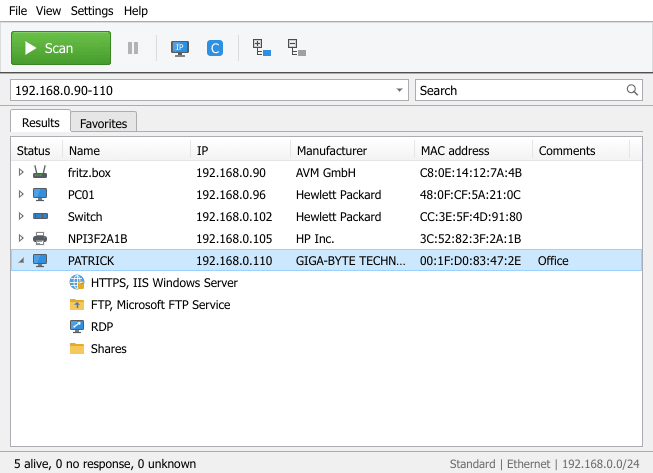
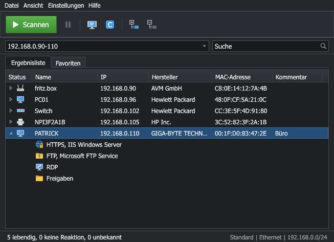

# IP Scanner Deluxe

[](https://github.com/ray77/ip-scanner-deluxe/actions/workflows/build.yml)


[English](README.md) | **Deutsch**

**Kostenloser IP Scanner und Netzwerkscanner** für Windows, Linux und macOS – komplett in Rust,
nativ gerendert (egui), ohne Browser, WebView, Electron, Cloud oder externe Tools.
Der IP Scanner findet alle Geräte im LAN, zeigt Name, IP-Adresse, MAC-Adresse und Hersteller,
erkennt Router, Drucker, NAS, PCs und Smart-Home-Geräte und öffnet HTTP, RDP, SSH, FTP und Freigaben
direkt aus der Liste. Bedienung und Layout orientieren sich eng an klassischen Windows-IP-Scannern:
Scan-Button, IP-Bereich, Ergebnisse/Favoriten-Tabs, Baumansicht mit Diensten, Statusleiste mit Zählern.

**[IP Scanner Deluxe aus dem Microsoft Store holen](https://apps.microsoft.com/detail/9ns53ffrbjhw?ocid=webpdpshare)**

**Download:** fertige Programme für Windows, Linux und macOS unter
[Releases](https://github.com/ray77/ip-scanner-deluxe/releases) bzw. als Build-Artefakte unter
[Actions](https://github.com/ray77/ip-scanner-deluxe/actions).

## Screenshots

| Hell | Dunkel |
|------|--------|
|  |  |

Die Screenshots werden reproduzierbar mit Demo-Daten erzeugt (ohne `--english` auf Deutsch):

```bash
cargo run -p ip-scanner-deluxe -- --english --demo --expand --screenshot docs/screenshots/light-expanded.png
```

```bash
cargo run -p ip-scanner-deluxe -- --english --demo --expand --theme dark --screenshot docs/screenshots/dark-expanded.png
```

## Features

- **Host-Erkennung**: ARP/Nachbartabelle, ICMP Echo (native Sockets bzw. `IcmpSendEcho`), TCP-Fallback, mDNS.
- **Namen**: Reverse-DNS, mDNS, LLMNR, NetBIOS (inkl. Arbeitsgruppe und MAC).
- **Hersteller**: Offline-IEEE-OUI-Datenbank (MA-L/MA-M/MA-S, Longest-Prefix-Match),
  Erkennung zufälliger MAC-Adressen („Private/Randomized“).
- **Geräteerkennung**: Fingerprint-Engine (Ports, Banner, HTTP-Titel/Server, TLS-Zertifikat,
  mDNS-Dienste, IPP, optional SNMP) mit Konfidenzwert und Belegen.
- **Dienste**: HTTP, HTTPS, FTP, SSH, RDP, SMB/Freigaben, Drucker, Datenbanken u. a. als Baumknoten.
- **Aktionen**: Ping (einmalig/dauerhaft), Traceroute, HTTP/HTTPS/FTP/SSH/RDP/SMB öffnen,
  Wake-on-LAN, Remote-Shutdown/-Neustart (Windows, immer mit Bestätigung).
- **Favoriten, eigene Namen, Kommentare**, Scan-Verlauf (neu/verschwunden/geändert).
- **Filter und Suche**, sortier-, verschieb- und ausblendbare Spalten.
- **Export**: CSV (Semikolon, optional mit BOM), JSON, HTML, XML; Import von Listen.
- **Hell-/Dunkelmodus**, Deutsch/Englisch/Spanisch/Italienisch, portabler Modus, Diagnosefenster, Log mit Rotation.

## Plattformen

| System | Architektur | Artefakt |
|--------|-------------|----------|
| Windows 10/11 | x86_64 | `IPScannerDeluxe.exe`, portables ZIP |
| Linux (glibc ≥ 2.35, X11/Wayland) | x86_64, aarch64 | `tar.gz`, `.deb`, `AppImage` |
| macOS 11+ | Apple Silicon, Intel | `.app` (ZIP), `.dmg` |

## Build-Anleitung

Voraussetzung: Rust ≥ 1.90 (`rustup`), unter Linux zusätzlich:

```bash
sudo apt-get install -y libxkbcommon-dev libgl1-mesa-dev libx11-dev libxcursor-dev libxrandr-dev libxi-dev libwayland-dev
```

Entwicklungsbuild und Start:

```bash
cargo run -p ip-scanner-deluxe
```

Qualitätsprüfungen (wie in der CI):

```bash
cargo fmt --all -- --check
```

```bash
cargo clippy --workspace --all-targets --all-features -- -D warnings
```

```bash
cargo test --workspace
```

### Projektstruktur

| Crate | Aufgabe |
|-------|---------|
| `vendor-db` | MAC-Parser, OUI-Import, redb-Herstellerdatenbank |
| `fingerprint` | Regeln und Engine zur Geräteklassifizierung |
| `protocols` | DNS, mDNS, LLMNR, NetBIOS, HTTP, TLS, IPP, SNMP, Banner, WOL |
| `platform` | Interfaces, Nachbartabelle, ICMP, Remote-Power, Client-Start (pro OS) |
| `scan-core` | Zielparser, Scan-Koordinator, Portprofile, Modell, Events |
| `storage` | Pfade, Einstellungen, Favoriten, Aliase, Verlauf (redb) |
| `ui` | Theme, Icons, Widgets, Tabelle, Menüs, Übersetzungen |
| `app` | Binary `IPScannerDeluxe`, Dialoge, Export, Werkzeuge |
| `xtask` | OUI-Import und Erzeugung von `assets/vendor.redb` |

## Release-Build

```bash
cargo build --release --locked -p ip-scanner-deluxe
```

Das Binary liegt unter `target/release/IPScannerDeluxe` (`.exe` unter Windows).
macOS-App lokal bauen (frisches Bundle unter `dist/IP Scanner Deluxe.app` plus ZIP):

```bash
cargo xtask bundle-macos
```

Installationspakete (ZIP, `.deb`, AppImage, `.app`, `.dmg`) baut die GitHub-Actions-CI
(`.github/workflows/build.yml`); bei einem Tag `v*` werden sie als Release veröffentlicht.
Die Paketierungsdateien liegen in `packaging/`. Jedes Release enthält `SHA256SUMS.txt` und
GitHub-Herkunftsnachweise (`gh attestation verify <datei> --repo ray77/ip-scanner-deluxe`).

**Microsoft Store**: Die Store-Version ist dasselbe Programm, gebaut mit `--features store` und
als MSIX paketiert; siehe [docs/MICROSOFT_STORE.md](docs/MICROSOFT_STORE.md) (englisch).

**Portabler Modus**: Liegt eine Datei `portable.flag` neben dem Programm, werden Einstellungen,
Datenbank und Logs im Programmordner gespeichert. Sonst:

- Windows: `%APPDATA%\IPScannerDeluxe`
- macOS: `~/Library/Application Support/IPScannerDeluxe`
- Linux: `~/.local/share/ip-scanner-deluxe`

## OUI-Datenbank

Die Herstellerdatenbank (`assets/vendor.redb`) wird aus den öffentlichen IEEE-Registern erzeugt
und fest ins Programm eingebettet – zur Laufzeit gibt es keine Online-Abfrage.

Aktualisieren (CSV-Dateien von `standards-oui.ieee.org` nach `assets/oui/` laden):

```bash
cargo xtask build-vendor-db
```

Alternativ lässt sich im Programm unter *Einstellungen → MAC-Datenbank* eine eigene CSV
importieren; sie überschreibt die eingebettete Datenbank und kann zurückgesetzt werden.

## Berechtigungen

- **Windows**: Keine Administratorrechte nötig (ICMP über `IcmpSendEcho`, ARP über `SendARP`).
  Remote-Shutdown benötigt passende Rechte auf dem Zielrechner.
- **Linux**: ICMP nutzt unprivilegierte Ping-Sockets (`net.ipv4.ping_group_range`). Ist das gesperrt,
  wird auf Raw-Sockets (`CAP_NET_RAW`) bzw. TCP-Erkennung ausgewichen. Das `.deb` setzt
  `cap_net_raw` auf das Binary. Manuell:

  ```bash
  sudo setcap cap_net_raw+ep /usr/bin/IPScannerDeluxe
  ```

- **macOS**: Beim ersten Scan fragt macOS nach dem Zugriff auf das **lokale Netzwerk**
  (`NSLocalNetworkUsageDescription`). Ohne Zustimmung sind ARP, ICMP und Verbindungen ins LAN
  blockiert oder stark verlangsamt. Nachträglich: *Systemeinstellungen → Datenschutz & Sicherheit →
  Lokales Netzwerk*. Nicht signierte Builds ggf. per Rechtsklick → *Öffnen* starten.

## Portprofile

| Profil | Ports |
|--------|-------|
| Schnell | 21, 22, 23, 53, 80, 139, 443, 445, 515, 548, 631, 3389, 5000, 5001, 5900, 8080, 8443, 9100 |
| Standard | Schnell + 25, 110, 135, 143, 389, 554, 636, 993, 995, 1400, 1433, 1521, 1883, 2375, 2376, 3000, 3306, 4899, 5353, 5432, 5672, 5985, 5986, 8000, 8006, 8008, 8009, 8123, 8883, 9200, 9443, 27017, 49000 |
| Genau | Standard + 81, 88, 111, 427, 873, 1080, 1194, 2049, 3260, 4443, 5060, 5601, 6379, 6443, 7000, 8001, 8002, 8081, 8088, 8181, 8291, 8888, 9000, 9090, 9091, 10000, 32400, 37777, 49443 |
| Benutzerdefiniert | frei, z. B. `22, 80, 8000-8010` |

Für die Host-Erkennung bei gefiltertem ICMP werden zusätzlich 22, 80, 443, 445, 3389, 8080, 8443,
9100, 135, 139, 53 und 5000 angefragt (eine Verbindungsablehnung zählt als „lebendig“).

## Datenschutz

- Alle Daten bleiben lokal. Es gibt keine Telemetrie, keine Cloud-Dienste und keine Online-Abfragen
  von Herstellern. Netzwerkverkehr entsteht ausschließlich zu den gescannten Zielen.
- Passwörter werden nicht gespeichert. Remote-Shutdown verwendet die Windows-Anmeldung des
  aktuellen Benutzers.
- Logs enthalten keine Passwörter, Tokens oder Schlüssel.
- SNMP ist standardmäßig aus, rein lesend (v2c GET) und nur mit explizit eingetragener Community –
  kein Durchprobieren von Communities.
- Scannen Sie nur Netzwerke, für die Sie berechtigt sind.

Vollständige Datenschutzerklärung: [PRIVACY.md](PRIVACY.md) (englisch und deutsch).

## Lizenzhinweise

Copyright © 2026 Dominik Schmidt. Dieses Projekt steht nach Wahl unter **MIT OR Apache-2.0**
(siehe `LICENSE-MIT`, `LICENSE-APACHE`).

Die Herstellerdaten stammen aus den öffentlichen IEEE-Registration-Authority-Listen
(MA-L, MA-M, MA-S). Die Namen und Adressen sind Eigentum der jeweiligen Registranten;
IEEE übernimmt keine Gewähr für die Daten.

Lizenzen und Copyright-Hinweise aller einkompilierten Rust-Bibliotheken stehen in
[`THIRD-PARTY-NOTICES.txt`](THIRD-PARTY-NOTICES.txt) (erzeugt mit cargo-about, auch unter
Hilfe > Über > Drittanbieter-Lizenzen). `cargo deny check licenses` prüft neue Abhängigkeiten in der CI.

Dieses Projekt ist ein eigenständiges Werk und steht in keiner Verbindung zu Famatech oder
Advanced IP Scanner.

## Troubleshooting

| Problem | Ursache / Lösung |
|---------|------------------|
| Warnung „ICMP Raw Socket nicht verfügbar“ | Ping-Sockets gesperrt. Linux: `setcap` (siehe oben). Der Scan funktioniert trotzdem per TCP/ARP, ist aber langsamer. |
| Keine MAC-Adressen / Hersteller | MACs gibt es nur im eigenen Subnetz; hinter Routern/VPN nicht ermittelbar. macOS: Zugriff auf lokales Netzwerk erlauben. |
| Scan unter macOS sehr langsam, keine Treffer | Berechtigung „Lokales Netzwerk“ fehlt oder wurde abgelehnt. |
| Linux: Fenster startet nicht | OpenGL/Wayland-Bibliotheken fehlen (`libgl1`, `libxkbcommon0`). Unter Wayland ggf. `WAYLAND_DISPLAY=` setzen, um X11 zu erzwingen. |
| Viele „unbekannt“-Hosts | Geräte ohne offene Ports und ohne Namensdienste. Profil „Genau“ verwenden. |
| Windows: Fenster träge oder Darstellungsfehler | Ohne Grafikkarte (virtuelle Maschinen, Windows Server) zeichnet das Programm auf der CPU, mit Grafikkarte per OpenGL mit Direct3D 12 als Ausweichlösung. Erzwingen mit der Umgebungsvariable `IPSD_RENDERER=software`, `wgpu` oder `glow`; das Log zeigt, welcher Renderer läuft. |
| Fenster öffnet sich nicht | Seit 0.1.4 erscheint eine Fehlermeldung; Details im Log (`%APPDATA%\IPScannerDeluxe\logs` unter Windows). |
| Fehlersuche | *Hilfe → Diagnose* zeigt Interfaces, ICMP-Status, DB-Version. Ausführliches Log mit `IPSD_LOG=debug`. |
