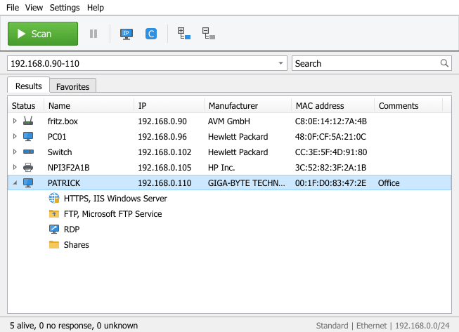
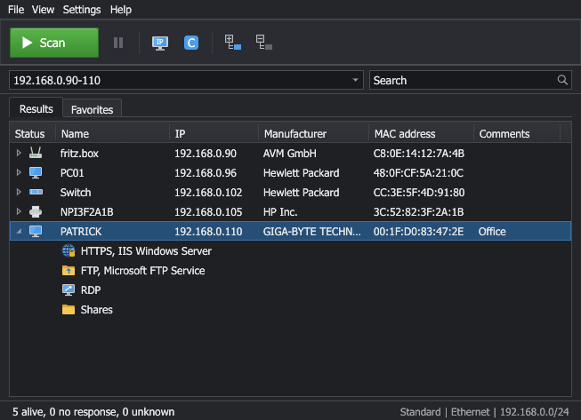

# IP Scanner Deluxe

[](https://github.com/ray77/ip-scanner-deluxe/actions/workflows/build.yml)


**English** | [Deutsch](README.de.md)

**Free IP scanner and network scanner** for Windows, Linux and macOS – written entirely in Rust,
rendered natively (egui), with no browser, WebView, Electron, cloud or external tools.
The IP scanner finds every device on your LAN, shows hostname, IP address, MAC address and vendor,
recognises routers, printers, NAS, PCs and smart-home devices, and opens HTTP, RDP, SSH, FTP and
shares straight from the list. Look and feel closely follow classic Windows IP scanners:
Scan button, IP range, Results/Favorites tabs, tree view with services, status bar with counters.

**Download:** ready-to-run builds for Windows, Linux and macOS are on the
[Releases](https://github.com/ray77/ip-scanner-deluxe/releases) page, and as build artifacts under
[Actions](https://github.com/ray77/ip-scanner-deluxe/actions).

## Screenshots

| Light | Dark |
|-------|------|
|  |  |

The screenshots are generated reproducibly from demo data (omit `--english` for the German UI):

```bash
cargo run -p ip-scanner-deluxe -- --english --demo --expand --screenshot docs/screenshots/light-expanded.png
```

```bash
cargo run -p ip-scanner-deluxe -- --english --demo --expand --theme dark --screenshot docs/screenshots/dark-expanded.png
```

## Features

- **Host discovery**: ARP/neighbour table, ICMP echo (native sockets or `IcmpSendEcho`), TCP fallback, mDNS.
- **Names**: reverse DNS, mDNS, LLMNR, NetBIOS (including workgroup and MAC).
- **Vendors**: offline IEEE OUI database (MA-L/MA-M/MA-S, longest-prefix match),
  detection of randomized MAC addresses ("Private/Randomized").
- **Device detection**: fingerprint engine (ports, banners, HTTP title/server, TLS certificate,
  mDNS services, IPP, optional SNMP) with confidence score and evidence.
- **Services**: HTTP, HTTPS, FTP, SSH, RDP, SMB/shares, printers, databases and more as tree nodes.
- **Actions**: ping (single/continuous), traceroute, open HTTP/HTTPS/FTP/SSH/RDP/SMB,
  Wake-on-LAN, remote shutdown/restart (Windows, always with confirmation).
- **Favorites, custom names, comments**, scan history (new/gone/changed).
- **Filter and search**, sortable, movable and hideable columns.
- **Export**: CSV (semicolon, optional BOM), JSON, HTML, XML; import of lists.
- **Light/dark theme**, German/English, portable mode, diagnostics window, rotating log.

## Platforms

| System | Architecture | Artifact |
|--------|--------------|----------|
| Windows 10/11 | x86_64 (runs on ARM64 via emulation) | `IPScannerDeluxe.exe`, portable ZIP |
| Linux (glibc ≥ 2.35, X11/Wayland) | x86_64, aarch64 | `tar.gz`, `.deb`, `AppImage` |
| macOS 11+ | Apple Silicon, Intel | `.app` (ZIP), `.dmg` |

The Windows `.exe` links the C runtime statically and needs no Visual C++ Redistributable.

## Building

Requirement: Rust ≥ 1.90 (`rustup`); on Linux additionally:

```bash
sudo apt-get install -y libxkbcommon-dev libgl1-mesa-dev libx11-dev libxcursor-dev libxrandr-dev libxi-dev libwayland-dev
```

Development build and run:

```bash
cargo run -p ip-scanner-deluxe
```

Quality checks (same as CI):

```bash
cargo fmt --all -- --check
```

```bash
cargo clippy --workspace --all-targets --all-features -- -D warnings
```

```bash
cargo test --workspace
```

### Project layout

| Crate | Purpose |
|-------|---------|
| `vendor-db` | MAC parser, OUI import, redb vendor database |
| `fingerprint` | Rules and engine for device classification |
| `protocols` | DNS, mDNS, LLMNR, NetBIOS, HTTP, TLS, IPP, SNMP, banners, WOL |
| `platform` | Interfaces, neighbour table, ICMP, remote power, client launch (per OS) |
| `scan-core` | Target parser, scan coordinator, port profiles, model, events |
| `storage` | Paths, settings, favorites, aliases, history (redb) |
| `ui` | Theme, icons, widgets, table, menus, translations |
| `app` | `IPScannerDeluxe` binary, dialogs, export, tools |
| `xtask` | OUI import and generation of `assets/vendor.redb`, macOS bundling |

## Release build

```bash
cargo build --release --locked -p ip-scanner-deluxe
```

The binary ends up in `target/release/IPScannerDeluxe` (`.exe` on Windows).
To build the macOS app locally (fresh bundle in `dist/IP Scanner Deluxe.app` plus ZIP):

```bash
cargo xtask bundle-macos
```

Installer packages (ZIP, `.deb`, AppImage, `.app`, `.dmg`) are built by GitHub Actions
(`.github/workflows/build.yml`); pushing a `v*` tag publishes them as a release.
Packaging files live in `packaging/`.

**Portable mode**: if a file named `portable.flag` sits next to the program, settings,
database and logs are stored in the program folder. Otherwise:

- Windows: `%APPDATA%\IPScannerDeluxe`
- macOS: `~/Library/Application Support/IPScannerDeluxe`
- Linux: `~/.local/share/ip-scanner-deluxe`

## OUI database

The vendor database (`assets/vendor.redb`) is generated from the public IEEE registries
and embedded in the program – there are no online lookups at runtime.

To update it, download the CSV files from `standards-oui.ieee.org` into `assets/oui/`, then run:

```bash
cargo xtask build-vendor-db
```

Alternatively, import your own CSV in the program under *Settings → MAC database*;
it overrides the embedded database and can be reset.

## Permissions

- **Windows**: no administrator rights needed (ICMP via `IcmpSendEcho`, ARP via `SendARP`).
  Remote shutdown requires suitable rights on the target machine.
- **Linux**: ICMP uses unprivileged ping sockets (`net.ipv4.ping_group_range`). If those are
  blocked, it falls back to raw sockets (`CAP_NET_RAW`) or TCP detection. The `.deb` sets
  `cap_net_raw` on the binary. Manually:

  ```bash
  sudo setcap cap_net_raw+ep /usr/bin/IPScannerDeluxe
  ```

- **macOS**: on the first scan macOS asks for access to the **local network**
  (`NSLocalNetworkUsageDescription`). Without consent, ARP, ICMP and LAN connections are blocked
  or heavily throttled. To change it later: *System Settings → Privacy & Security → Local Network*.
  Start unsigned builds with right-click → *Open* if needed.

## Port profiles

| Profile | Ports |
|---------|-------|
| Fast | 21, 22, 23, 53, 80, 139, 443, 445, 515, 548, 631, 3389, 5000, 5001, 5900, 8080, 8443, 9100 |
| Standard | Fast + 25, 110, 135, 143, 389, 554, 636, 993, 995, 1400, 1433, 1521, 1883, 2375, 2376, 3000, 3306, 4899, 5353, 5432, 5672, 5985, 5986, 8000, 8006, 8008, 8009, 8123, 8883, 9200, 9443, 27017, 49000 |
| Accurate | Standard + 81, 88, 111, 427, 873, 1080, 1194, 2049, 3260, 4443, 5060, 5601, 6379, 6443, 7000, 8001, 8002, 8081, 8088, 8181, 8291, 8888, 9000, 9090, 9091, 10000, 32400, 37777, 49443 |
| Custom | anything, e.g. `22, 80, 8000-8010` |

For host discovery when ICMP is filtered, ports 22, 80, 443, 445, 3389, 8080, 8443, 9100, 135,
139, 53 and 5000 are probed as well (a refused connection counts as "alive").

## Privacy

- All data stays local. There is no telemetry, no cloud service and no online vendor lookup.
  Network traffic goes only to the targets you scan.
- Passwords are never stored. Remote shutdown uses the current user's Windows login.
- Logs contain no passwords, tokens or keys.
- SNMP is off by default, read-only (v2c GET) and only uses an explicitly entered community –
  no community brute-forcing.
- Only scan networks you are authorized to scan.

## License notes

This project is licensed under **MIT OR Apache-2.0** (see `LICENSE-MIT`, `LICENSE-APACHE`).

Vendor data comes from the public IEEE Registration Authority lists (MA-L, MA-M, MA-S).
Names and addresses belong to the respective registrants; IEEE makes no warranty about the data.

The Rust libraries used (including egui/eframe, tokio, redb, rustls, mdns-sd) are licensed under
MIT, Apache-2.0, ISC or BSD licenses; `Cargo.lock` lists them all.

This project is an independent work and is not affiliated with Famatech or Advanced IP Scanner.

## Troubleshooting

| Problem | Cause / fix |
|---------|-------------|
| Warning "ICMP not available" | Ping sockets are blocked. Linux: `setcap` (see above). Scanning still works via TCP/ARP, just slower. |
| No MAC addresses / vendors | MACs are only visible in your own subnet; not behind routers/VPN. macOS: allow local network access. |
| Scan very slow on macOS, no results | "Local Network" permission is missing or was denied. |
| Linux: window does not open | OpenGL/Wayland libraries missing (`libgl1`, `libxkbcommon0`). On Wayland, set `WAYLAND_DISPLAY=` to force X11. |
| Many "unknown" hosts | Devices without open ports or name services. Use the "Accurate" profile. |
| Windows in a VM finds almost nothing | The VM uses NAT. Switch the VM network to bridged mode so it sees your real LAN. |
| Debugging | *Help → Diagnostics* shows interfaces, ICMP status, DB version. Verbose log with `IPSD_LOG=debug`. |
